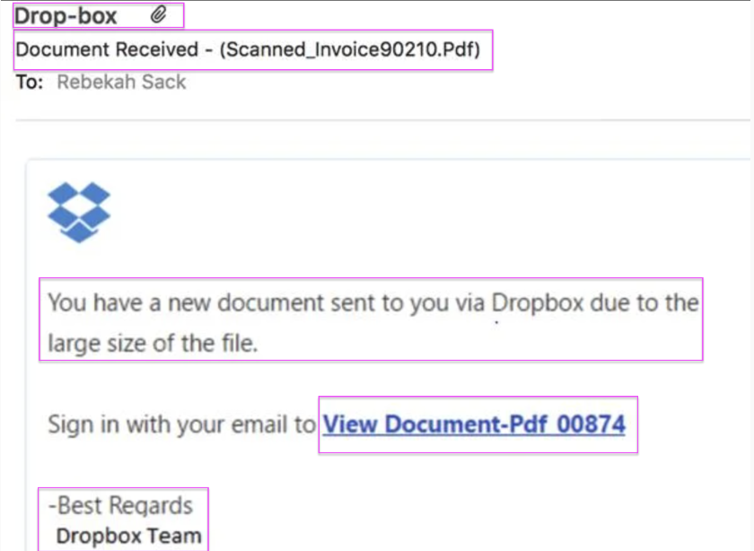
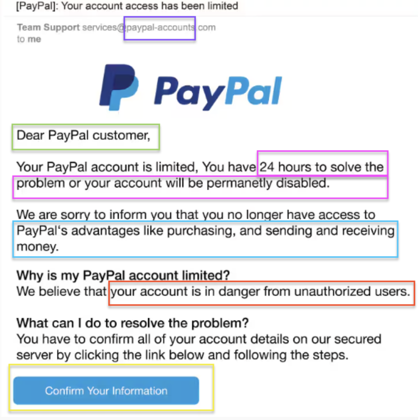

SOC simulation exploring phishing detection, email security, and threat analysis.

# ✦ Phishing Email Threat Analysis

### 🛡️ Cybersecurity | SOC Simulation | Email Security

*A hands-on cybersecurity investigation exploring phishing techniques, suspicious email indicators, and security best practices.*

---

**PROJECT 001** · **CYBERSECURITY** · **THREAT ANALYSIS**

## ✦ 01 / Project Overview

This project focuses on identifying and analyzing phishing attempts through a simulated Security Operations Center (SOC) investigation.

I examined suspicious email samples to identify potential phishing indicators, evaluate security risks, and recommend appropriate protective measures.

The investigation includes two phishing scenarios involving an invoice-themed email and a fraudulent PayPal account notification.

---

## ✦ 02 / Investigation Cases

### 🔍 Case 01 — Invoice-Themed Phishing

**Category:** Email Phishing / Social Engineering

**Investigation Focus:**
An invoice-themed email that used a file-sharing service as part of its phishing approach.

**Analysis:**

This investigation focused on identifying suspicious characteristics within the email and evaluating how an attacker might use invoice-related messaging to encourage a recipient to interact with potentially malicious content.

**Evidence:**

---

### 🔍 Case 02 — PayPal Account Limitation

**Category:** Brand Impersonation / Credential Phishing

**Investigation Focus:**
A suspicious email impersonating PayPal and claiming that the recipient's account had been limited.

**Analysis:**

This investigation examined how attackers use recognizable brands, urgent account warnings, and verification requests to encourage recipients to reveal sensitive information.

**Evidence:**

---

## ✦ 03 / Key Security Concepts

| Security Concept | Application |
|---|---|
| Phishing Detection | Identifying suspicious characteristics in emails |
| Social Engineering | Recognizing attempts to manipulate recipients |
| Brand Impersonation | Examining fraudulent messages claiming to represent legitimate organizations |
| Threat Analysis | Evaluating potential risks associated with suspicious messages |
| Security Awareness | Understanding how users can recognize and avoid phishing attempts |

---

## ✦ 04 / Security Recommendations

Based on the investigation, recommended security practices include:

- Verify suspicious messages through official communication channels.
- Avoid clicking unexpected links or downloading unverified attachments.
- Inspect sender information and message content for inconsistencies.
- Use multifactor authentication (MFA) when available.
- Report suspected phishing messages through appropriate security channels.
- Promote security awareness to reduce social engineering risks.

---

## ✦ 05 / Skills Demonstrated

`Cybersecurity Fundamentals` · `Phishing Analysis` · `Threat Identification` · `Email Security` · `Security Documentation`

---

## ✦ 06 / Project Reflection

This project helped me develop a better understanding of how phishing attacks work and how social engineering techniques can be used to manipulate recipients.

By examining suspicious email scenarios, I practiced identifying security warning signs, assessing potential threats, and communicating findings through structured documentation.

The investigation strengthened my foundational cybersecurity knowledge and introduced me to the analytical thinking involved in security operations.

---

### ✦ Thanks for exploring my project!

*Part of my cybersecurity & cloud computing learning journey.*

🎀 **apricotbytes**

